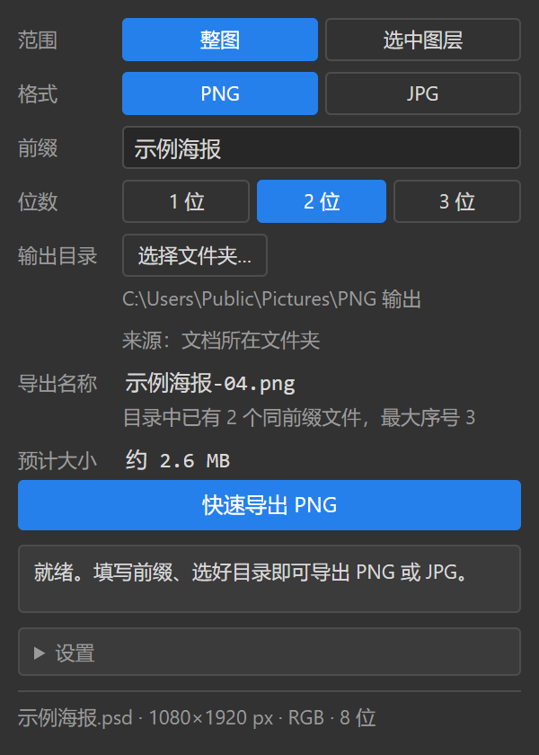
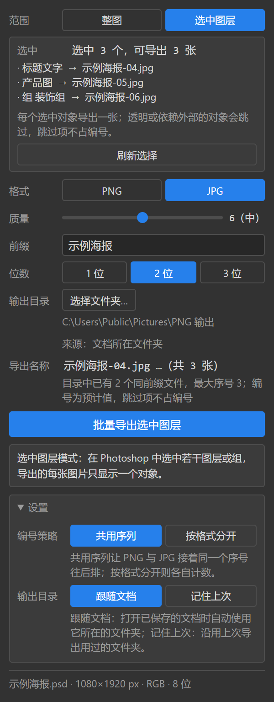
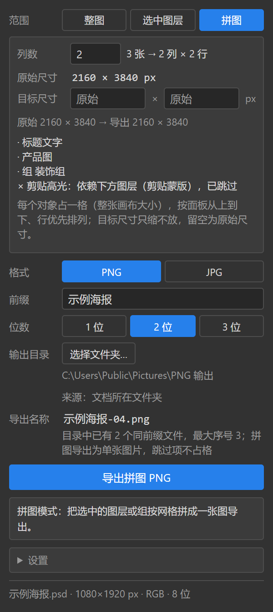

# Photoshop Quick PNG Export

Photoshop PNG / JPG 导出面板，按 `前缀-编号.png`（或 `.jpg`）保存当前文档，把当前选中的图层 / 图层组批量导出成多张图片，或把这些选中对象拼成一张网格拼图。导出时读取目标文件夹中的已有编号，接续保存，避免覆盖同名文件。

支持 PNG 与 JPG 两种格式、JPG 质量调节、导出前大小预估、透明背景、中文前缀和编号位数设置，并记住输出目录、格式与上次使用的前缀。

## 界面

| 整张画面模式 | 选中图层模式 | 拼图模式 |
| --- | --- | --- |
|  |  |  |

## 安装

Windows 安装包：[下载最新版本](https://github.com/FleatherYu/photoshop-quick-png-export/releases/latest)。

1. 下载并解压 `photoshop-quick-png-export-v版本号.zip`。
2. 运行解压目录中的 `install.cmd`，等待窗口显示 `Done.`。
3. 完全退出并重新启动 Photoshop。
4. 从「窗口 → 扩展功能 → Photoshop Quick PNG Export」打开面板。

安装脚本将面板复制到以下用户目录，并启用加载未签名 CEP 面板所需的 `PlayerDebugMode`：

```text
%APPDATA%\Adobe\CEP\extensions\com.fleatheryu.pngsmartexport
```

面板基于 Photoshop CC 2019（20.0）/ CEP 9 开发。Photoshop 2020 及更新版本尚未实测，不保证兼容。

## 使用

打开 Photoshop 文档，在面板中设置格式（PNG / JPG）、前缀、编号位数和输出文件夹，点击「快速导出 PNG」或「快速导出 JPG」。导出后会显示文件完整路径，点击「打开目录」可查看。

选择 JPG 后可以拖动质量滑块（0–12，默认 10，同时显示「低 / 中 / 高 / 最佳」档位）。「预计大小」会按与实际导出完全相同的保存参数临时保存一次并读取文件大小，显示「约 X MB」；拖动滑块时只在松手后重新估算。JPG 的透明区域会填成白色，源文档不受影响。

面板底部的「设置」可以调整两项策略：

- **编号策略**：`共用序列`（默认）让 PNG 与 JPG 接在同一个序号后面；`按格式分开` 则 PNG 与 JPG 各自从 1 计数。
- **默认输出目录**：`跟随文档`（默认）在切换到已保存的文档时自动使用该文档所在的文件夹，同一文档内手动选择的目录不会被覆盖；`记住上次` 则沿用上次导出用过的文件夹。没有保存过的新文档没有所在文件夹，会退回上次使用的目录。

面板顶部可以切换导出模式：

- **整张画面**（默认）：导出当前文档的完整画面，一次一张；
- **选中图层**：先在 Photoshop 图层面板里选中若干图层 / 组，再点导出。每个选中对象单独导出一张，按图层面板的从上到下顺序编号，沿用同一套 `前缀-编号.png` / `.jpg` 规则（编号策略同样生效）。导出前会在面板里列出将要导出的对象和预计文件名。
- **拼图**：同样先在 Photoshop 里选中若干图层 / 组，再设置列数，点击「导出拼图 PNG」或「导出拼图 JPG」，把选中对象拼成一张网格图。每个格子是完整画布大小，对象保持它在原画布里的位置，不裁剪、不居中、不留缝；按面板顺序从左到右、从上到下填格。可以只缩小整张拼图的尺寸，不支持放大。

拼图模式的约定：

- 列数默认取 `√N` 向上取整（`N` 为可导出的对象数），修改过的列数会被记住；列数大于 `N` 时按 `N` 处理并提示；
- 行数由 `ceil(N / 列数)` 自动计算，面板显示「N 张 → C 列 × R 行」以及原始拼图尺寸（列数 × 画布宽、行数 × 画布高）；
- 目标宽 / 高锁定比例：填一个，另一个自动换算（至少 1 px）；两个都空表示保持原始尺寸；输入大于原始尺寸会提示且不导出（不支持放大）；
- 拼图是一张图，编号、格式、JPG 质量、编号策略和输出目录规则与 1.2.0 完全一致，不覆盖已有文件；
- 完全透明的对象、与外部有依赖的对象会被跳过且不占格子，结果里会说明原因；末尾没有填满的格子，PNG 是透明的，JPG 是白色的；
- 目标尺寸不会跨选择保留：切换选择或文档时清空，避免用旧尺寸误导出。

选中图层模式下的约定：

- 同时选中父组和它的子层时，只导出父组（子层不会重复导出）；
- 每张图只显示该对象，其他图层隐藏；组内原有的子层可见性、剪贴关系和内部效果保持不变；
- 明确选中的隐藏图层也会导出；
- 对象完全透明（如空图层、空组）时跳过，不占用编号；
- 与对象外部存在依赖关系（剪贴蒙版、调整图层、非正常混合模式、穿透组等）时，单独导出会失真，该对象会被跳过并在结果里说明原因；
- 某项导出失败时整批停止，已成功导出的文件保留；再次导出会从目录中的最大编号继续，不覆盖、不补空缺。

前缀默认使用文档名。切换文档时会自动更新；手动修改后，在同一文档中保留该设置。默认输出目录跟随文档所在文件夹；选择「记住上次」模式时则沿用上次导出的目录。

## 文件命名

文件名格式为 `前缀-编号.png` 或 `前缀-编号.jpg`（扩展名小写）。例如，前缀为 `261028-123`、编号位数为 2 时，依次导出为：

```text
261028-123-01.png
261028-123-02.png
261028-123-03.png
```

- 编号从目标文件夹中相同前缀的最大编号继续，不补空缺。例如已有 `-01` 和 `-03`，下一张为 `-04`。
- 编号位数仅控制补零，不限制编号长度。设置为 2 位时，第 100 张仍为 `-100.png`。
- 编号策略为「共用序列」（默认）时，`前缀-数字.png`、`前缀-数字.jpg`、`前缀-数字.jpeg` 一起参与取最大编号（例如已有 `-03.png`，接着导出 JPG 会得到 `-04.jpg`）。
- 编号策略为「按格式分开」时，只统计与本次导出格式相同的文件（同上目录导出 JPG 会得到 `-01.jpg`）。
- 不同前缀分别计数。只有完整匹配 `前缀-数字.扩展名` 的文件参与编号，`前缀-1 (1).png`、`前缀-abc.png` 等文件不计入。
- 任何模式下都不会覆盖已有文件：写入前会再次确认目标文件名不存在。

## 色彩模式与位深

导出 CMYK、灰度、Lab 或 16/32 位文档时，面板会创建临时副本，转换为 8 位 RGB 后保存，不修改原文档。转换可能产生色差，面板会显示提示。

导出 JPG 时，面板始终在临时副本上把透明区域填成白色再合并图层，源文档的图层、透明度和颜色模式保持不变。

## 故障排查

### 扩展菜单中没有面板

确认已完全退出并重启 Photoshop，检查安装目录是否存在。Photoshop 2020 及更新版本尚未实测，可能存在兼容问题。

### 安装脚本无法运行或窗口一闪而过

确认已解压安装包，不要直接从压缩包内运行脚本。如果文件被 Windows 阻止，可在确认来源可信后，右键 ZIP →「属性」，检查是否有「解除锁定」选项，解除后重新解压。

如需查看错误信息，可从命令提示符中运行 `install.cmd`。

### 导出失败

检查是否已打开 Photoshop 文档、是否已选择输出文件夹，并查看面板中的具体错误提示。

## 卸载

运行安装包中的 `uninstall.cmd`，然后重启 Photoshop。卸载脚本只删除面板文件，不清除 Photoshop 的其他设置。

## 开发

界面使用 HTML/CSS/JS，Photoshop 端使用 ExtendScript。

`jsx/host.jsx` 由 `jsx/core.jsx` 和 `jsx/host-body.jsx` 生成：

```sh
node scripts/build-host.mjs
```

运行测试（使用 Node 内建测试，无需 `npm install`）：

```sh
node --test --test-isolation=none "tests/*.test.mjs"
```

通过 COM 调用 Photoshop 进行验收：

```powershell
powershell -ExecutionPolicy Bypass -File scripts\verify-photoshop.ps1
powershell -ExecutionPolicy Bypass -File scripts\verify-batch-photoshop.ps1
powershell -ExecutionPolicy Bypass -File scripts\verify-jpg-photoshop.ps1
powershell -ExecutionPolicy Bypass -File scripts\verify-collage-photoshop.ps1
```

`verify-batch-photoshop.ps1` 会跑 `tests/photoshop/batch-acceptance.jsx`（真实多选、组内剪贴 / 隐藏子层、16 位转换、外部剪贴依赖、空文档、displayDialogs 恢复等），并检查导出的 PNG 像素。`verify-jpg-photoshop.ps1` 会跑 `tests/photoshop/jpg-acceptance.jsx`，覆盖 JPG 质量与预估大小、透明填白、两种编号策略、批量 JPG 跳过空对象等场景，并检查 JPEG 签名与像素。`verify-collage-photoshop.ps1` 会跑 `tests/photoshop/collage-acceptance.jsx`，逐格取像素验证拼图顺序与位置、空格子透明 / 白色、目标尺寸与放大拒绝、跳过项不占格、源文档不变与临时文件清理。

- 验收记录：[`docs/acceptance.md`](docs/acceptance.md)
- 设计说明：[`docs/design.md`](docs/design.md)
- `install.cmd` / `uninstall.cmd` 分别调用 `scripts\install.ps1` / `scripts\uninstall.ps1`。

## 限制

- 图层批量导出只处理当前选中的图层 / 组，不提供「导出全部图层」或面板内勾选对象；首版没有逐项进度和取消，执行期间不能重复触发。
- 跨对象依赖（剪贴蒙版、调整图层、非正常混合、穿透组、祖先效果）不会被自动带入，相关对象会被跳过并在结果里说明。
- 输出目录必须已存在，面板不会自动创建文件夹。
- 大小预估需要临时保存一次文件，文档很大时会多花几秒；期间面板仍可操作，但导出会等估算结束或直接以导出优先。
- JPG 固定把透明区域填成白色，暂不提供自定义底色、渐进式或元数据选项。
- 拼图固定「格子 = 完整画布」、无缝隙无外边距、按行优先填充，不提供自定义间距、底色、裁剪到内容、对齐或放大；对象很多或画布很大时，拼图尺寸增长很快（单边超过 Photoshop 的 300000 px 上限会直接报错）。
- 安装脚本仅支持 Windows；macOS 尚未实测，也未提供安装脚本。

## 后续计划

- **支持更多 Photoshop 版本**：目前只在 Photoshop CC 2019（20.0，CEP 9）上开发并实测；
  后续会在 Photoshop 2020 及更新版本上逐一验证，修正清单版本、`PlayerDebugMode`
  位置等兼容性问题。
- **扩充依赖支持矩阵**：按真实样例逐步支持整组依赖、调整图层等场景，减少跳过。
- **逐项进度与取消**：批量较大时提供进度反馈和中断能力。
- **更多 JPG 选项**：按需评估渐进式编码、自定义底色等。
